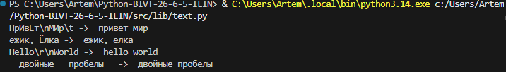
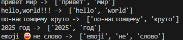
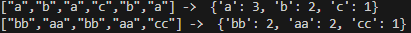
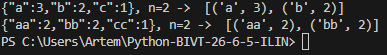
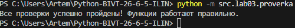
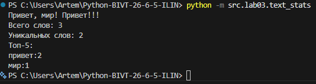

# ЛР3 — Тексты и частоты слов (словарь/множество)

ЦЕЛЬ РАБОТЫ:
Освоить базовые методы предобработки текстовых данных на языке Python.

## Задание А(функции)

### Normalize

- Приводит текст к нижнему регистру (или casefold).
- Опционально заменяет буквы 'ё' на 'е'.
- Убирает невидимые управляющие символы (табы, переносы строк).
- Схлопывает повторяющиеся пробелы в один и убирает пробелы по краям.

```py
def normalize(text: str, *, casefold: bool = True, yo2e: bool = True) -> str:
    if type(text)!= str:
        raise TypeError("Текст должен быть строкой") # Проверка 
    
    if len(text.strip()) == 0:
        raise ValueError('Пустое значение') # Проверка 
    
    result = text # Переменная под результат
    if casefold:
        result = result.casefold() # Убираем знаки, которых нет в питоне, доводим до маленького регистра
    else:
        result = result.lower() 
    
    if yo2e:
        result = result.replace('ё','е') # Замена регистра и букв е/ё
        result = result.replace('Ё','Е')
    
    result = result.replace('\t',' ') # Заменяем все ненужные знаки и буквы на пробелы
    result = result.replace('\r',' ')
    result = result.replace('\n',' ')

    result = re.sub(r' +', ' ', result) # Двойный пробелы сводим к одному

    result = result.strip() # Убираем пробелы слева и справа
    
    return result


```
Вывод



### tokenize

Использует регулярное выражение для поиска последовательностей букв, 
цифр и подчеркиваний, включая дефисы внутри слов (например, "по-настоящему").
Эмодзи и знаки препинания игнорируются.

```py
def tokenize(text: str) -> list[str]:
    if type(text)!= str:
        raise TypeError("Текст должен быть строкой") # Проверка 
    
    result = text

    result = re.findall(r"\w+(?:-\w+)*", text) #  Разбитие слово - слово

    return result


```
Вывод



### Count_freq

Проходит по списку токенов и формирует словарь, где ключом является слово,
а значением — количество его вхождений в текст.

```py
def count_freq(tokens: list[str]) -> dict[str, int]:
    if type(tokens) != list:
        raise TypeError('Нужен список слов') # Проверка 
    
    if len(tokens) == 0:
        raise ValueError('Список пустой') # Проверка 

    result = {} 
    for word in tokens:
        result[word] = tokens.count(word) # Записываем в словарь сколько раз встречается конкретное слово

    return result


```
Вывод



### Top_n

Преобразует словарь частот в список кортежей и сортирует его:
- По убыванию частоты.
- При равенстве частот — по алфавиту (возрастанию).
Возвращает первые N элементов.

```py
def top_n(freq: dict[str, int], n: int = 5) -> list[tuple[str, int]]:
    
    if type(freq) != dict:
        raise ValueError('Неправильный ввод данных') # Проверка 
    
    if len(freq) == 0:
        raise ValueError('Словарь пуст') # Проверка 

    if n == 0:
        raise ValueError('Нет слов') # Проверка 

    result = list(freq.items()) # Создаем список из ключей и их слов

    return sorted(result, key=lambda p: (-p[1],p[0]))[:n] 
    # key возвращает кортеж (-счёт, слово).
    # Кортежи сравниваются по первому элементу, при равенстве — по второму: сначала по убыванию счёта, при равных — по алфавиту.
    # Минус перед счётом — вместо reverse=True, чтобы слова при этом шли по возрастанию[:n] — срез списка пар, первые n

```
Вывод



### Проверка через assert
```py
from src.lib.text import count_freq, normalize, tokenize, top_n

assert normalize("ПрИвЕт\nМИр\t") == "привет мир", "Ошибка в normalize (регистр/пробелы)"
assert normalize("ёжик, Ёлка") == "ежик, елка", "Ошибка в normalize (замена ё/е)"
assert normalize("Hello\r\nWorld") == "hello world", "Ошибка в normalize (управляющие символы)"
assert normalize("  двойные   пробелы  ") == "двойные пробелы", "Ошибка в normalize (схлопывание пробелов)"

assert tokenize("привет мир") == ["привет", "мир"], "Ошибка в tokenize (обычные слова)"
assert tokenize("hello,world!!!") == ["hello", "world"], "Ошибка в tokenize (знаки препинания)"
assert tokenize("по-настоящему круто") == ["по-настоящему", "круто"], "Ошибка в tokenize (дефисы)"
assert tokenize("2025 год") == ["2025", "год"], "Ошибка в tokenize (числа)"
assert tokenize("emoji 😀 не слово") == ["emoji", "не", "слово"], "Ошибка в tokenize (эмодзи)"

assert count_freq(["a", "b", "a", "c", "b", "a"]) == {"a": 3, "b": 2, "c": 1}, "Ошибка в count_freq (базовый подсчет)"
assert count_freq(["bb", "aa", "bb", "aa", "cc"]) == {"bb": 2, "aa": 2, "cc": 1}, "Ошибка в count_freq (порядок ключей)"

assert top_n({"a": 3, "b": 2, "c": 1}, 2) == [("a", 3), ("b", 2)], "Ошибка в top_n (сортировка по убыванию)"
assert top_n({"aa": 2, "bb": 2, "cc": 1}, 2) == [("aa", 2), ("bb", 2)], "Ошибка в top_n (сортировка по алфавиту при равенстве)"

print("Все проверки успешно пройдены! Функции работают правильно.")
```
Вывод



## Задание В
Скрипт читает текст из `stdin`,
вызывает функции из `src/lib/text.py` и печатает статистику:
- Общее количество слов.
- Количество уникальных слов.
- Топ-5 самых частых слов в формате `слово:кол-во` (по убыванию частоты).
```py

from src.lib.text import normalize, tokenize, top_n, count_freq

def text_stat(text: str):
    tokens = tokenize(normalize(text))
    freq = count_freq(tokens)
    top = top_n(freq)

    print(f"Всего слов: {len(tokens)}")
    print(f"Уникальных слов: {len(freq)}")
    print("Топ-5:")

    for word, count in top:
        print(f"{word}:{count}")


text = input()
text_stat(text)

```

Вывод

