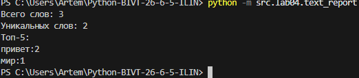

# ЛР4 — Текстовые отчёты и CSV (I/O + статистика)

ЦЕЛЬ РАБОТЫ:
Освоить чтение/запись файлов и CSV на Python, научиться разделять
файловый слой и логику, применять функции из ЛР3 (normalize,
tokenize, count_freq, top_n) к реальным файлам.

## Задание А — модуль `src/lab04/io_txt_csv.py`

Три кирпича: чтение текста, запись CSV, создание папок.


### read_text()
```py
import csv                                  # стандартный модуль для работы с CSV
from pathlib import Path                    # удобная работа с путями к файлам
from typing import Iterable, Sequence       # типы: Iterable — любой итерируемый объект, Sequence — список/кортеж


def read_text(path: str | Path, encoding: str = "utf-8") -> str:
    """
    Читает текстовый файл и возвращает его содержимое одной строкой.
    FileNotFoundError и UnicodeDecodeError не перехватываются, пусть всплывают.
    Другую кодировку можно указать явно, например: encoding="cp1251".
    """
    # Path(path) — превращает строку или Path в объект Path
    # read_text(encoding=...) — открывает файл, читает всё содержимое и закрывает его
    return Path(path).read_text(encoding=encoding)

```

### write_csv()
```py
def write_csv(rows: Iterable[Sequence], path: str | Path,
              header: tuple[str, ...] | None = None) -> None:
    """
    Создаёт или перезаписывает CSV-файл (разделитель — запятая).
    rows   — строки данных; все строки должны иметь одинаковую длину.
    header — необязательный заголовок, пишется первой строкой.
    Если rows пуст и header=None, создаётся пустой файл.
    """
    # Превращаем rows в список списков: нужно проверить длины и пройти по данным дважды
    rows = [list(row) for row in rows]

    if rows:
        # Запоминаем длину первой строки как эталон
        width = len(rows[0])
        for row in rows:
            # Если длина строки не совпадает с эталоном — останавливаемся с понятной ошибкой
            if len(row) != width:
                raise ValueError("Все строки CSV должны иметь одинаковую длину.")
        # Заголовок тоже должен совпадать по длине со строками данных
        if header is not None and len(header) != width:
            raise ValueError("Длина заголовка не совпадает с длиной строк.")

    # Создаём папку для файла, если её ещё нет
    ensure_parent_dir(path)
    # newline="" — отключает автоматическую замену перевода строки;
    with Path(path).open("w", newline="", encoding="utf-8") as f:
        writer = csv.writer(f)
        # Если заголовок задан — пишем его первой строкой
        if header is not None:
            writer.writerow(header)
        # writerows записывает все строки данных по очереди
        writer.writerows(rows)
```

### ensure_parent_dir()
```py
def ensure_parent_dir(path: str | Path) -> None:
    """Создаёт родительские папки для файла, если их нет."""
    # Path(path).parent — папка, в которой лежит файл
    # mkdir(parents=True) — создать всю цепочку папок, если её нет
    # exist_ok=True — не падать, если папка уже существует
    Path(path).parent.mkdir(parents=True, exist_ok=True)
```


### Запуск - data/lab04/input.py
```py
from src.lab04.io_txt_csv import read_text, write_csv

txt = read_text("data/lab04/input.txt")  # читаем файл один раз
write_csv([("test",3)], "data/lab04/check.csv", header=("word","count"))  # создаст CSV, заголовок передаём через header
print(repr(txt)) # repr покажет текст вместе с кавычками и служебными символами
# repr покажет лишние пробелы и переносы строк, которые иначе не видны.
```
Вывод:


Содержимое check.csv:
```py
word,count
test,3
```
## Задание B - модуль `src/lab04/text_report.py`
```py
import argparse                                     # Для приёма аргументов из консоли (--in, --out, --encoding)
import sys                                          # Для sys.exit() и вывода ошибок в sys.stderr
from pathlib import Path                            

from src.lib.text import normalize, tokenize, count_freq, top_n   
from src.lab04.io_txt_csv import read_text, write_csv             


def read_and_tokenize(file_path: str | Path, encoding: str) -> list[str]:
    """Читает файл и возвращает список нормализованных слов (токенов)."""
    text = read_text(file_path, encoding=encoding)  
    norm_text = normalize(text)                     
    tokens = tokenize(norm_text)                   
    return tokens                                   

def sorted_word_counts(freq: dict[str, int]) -> list[tuple[str, int]]:
    """Сортирует словарь частот: count , при равенстве word ."""
    items = freq.items() # Получаем пары (слово, частота) из словаря
    # Сортируем по ключу: сначала -частота (минус для убывания), потом само слово (по алфавиту)
    return sorted(items, key=lambda pair: (-pair[1], pair[0]))


def main() -> None:
    """Главная функция: разбирает аргументы, запускает логику, пишет отчёт."""
    # 1. Настраиваем парсер аргументов командной строки
    parser = argparse.ArgumentParser(description="Частотный отчёт по словам (ЛР4)") #ArgumentParser создаёт «описание» программы, какие аргументы она принимает.
    
    # Аргумент --in: путь к входному файлу. Если не указан, берется data/lab04/input.txt
    parser.add_argument("--in", dest="input_file", default="data/lab04/input.txt", help="Путь к входному файлу")
    
    # Аргумент --out: путь к выходному CSV. По умолчанию data/lab04/report.csv
    parser.add_argument("--out", dest="output_file", default="data/lab04/report.csv", help="Путь к выходному CSV")
    
    # Аргумент --encoding: кодировка файла. По умолчанию utf-8
    parser.add_argument("--encoding", default="utf-8", help="Кодировка файла (например, cp1251)")
    
    # Читаем аргументы, которые ввел пользователь в консоли
    args = parser.parse_args()

    # 2. Блок try-except для обработки ошибок чтения файла
    try:
        # Получаем список слов из файла (вызываем нашу функцию)
        tokens = read_and_tokenize(args.input_file, encoding=args.encoding)
    except FileNotFoundError as e:
        # Если файл не найден, печатаем ошибку в поток ошибок (stderr) и выходим
        print(f"Ошибка: файл не найден: {e.filename}", file=sys.stderr)
        sys.exit(1)
    except UnicodeDecodeError:
        # Если файл не читается в указанной кодировке, подсказываем пользователю
        print(f"Ошибка кодировки. Попробуйте добавить --encoding cp1251", file=sys.stderr)
        sys.exit(1)

    # 3. Считаем частоты слов
    freq = count_freq(tokens)  # Получаем словарь вида {"привет": 2, "мир": 1}

    # 4. Сортируем словарь по правилу: count , word 
    sorted_rows = sorted_word_counts(freq)

    # 5. Сохраняем результат в CSV-файл
    # Передаем заголовок ("word", "count"). Если слов нет, файл будет содержать только заголовок.
    write_csv(sorted_rows, args.output_file, header=("word", "count"))

    # 6. Печатаем краткое резюме в консоль
    print(f"Всего слов: {len(tokens)}")            # Общее количество токенов (сумма всех частот)
    print(f"Уникальных слов: {len(freq)}")         # Количество ключей в словаре freq
    print("Топ-5:")                                # Заголовок для списка
    
    # Получаем топ-5 слов (функция из ЛР3) и выводим их в формате слово:кол-во
    for word, cnt in top_n(freq, n=5):
        print(f"{word}:{cnt}")


# Эта конструкция гарантирует, что main() запустится только при прямом запуске скрипта
if __name__ == "__main__":
    main()  # Вызываем главную функцию
```
Запуск: 
```
python -m src.lab04.text_report
```
Вывод:

