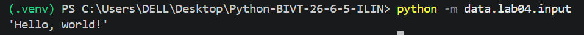

# ЛР4 — Текстовые отчёты и CSV (I/O + статистика)

ЦЕЛЬ РАБОТЫ:
Освоить чтение/запись файлов и CSV на Python, научиться разделять
файловый слой и логику, применять функции из ЛР3 (normalize,
tokenize, count_freq, top_n) к реальным файлам.

## Задание А — модуль `src/lab04/io_txt_csv.py`

Три кирпича: чтение текста, запись CSV, создание папок.


### read_text()
```py
from pathlib import Path
import csv


def read_text(path: str | Path, encoding: str = "utf-8") -> str:
    """
    Читает текстовый файл и возвращает его содержимое одной строкой.

    Для другой кодировки можно передать, например, encoding="cp1251".
    """
    p = Path(path) # превращаем путь в объект Path, чтобы строка и path работали одинаково.
    return p.read_text(encoding=encoding)

```

### write_csv()
```py
def write_csv(rows: Iterable[Sequence], path: str | Path,
              header: tuple[str, ...] | None = None) -> None:
    """
    Создаёт или перезаписывает CSV-файл (разделитель — запятая).
    rows   — строки данных; все строки должны иметь одинаковую длину.
    header — необязательный заголовок, пишется первой строкой.
    Если rows пуст и header=None, создаётся пустой файл.
    """
    # Превращаем rows в список списков: нужно проверить длины и пройти по данным дважды
    rows = [list(row) for row in rows]

    if rows:
        # Запоминаем длину первой строки как эталон
        width = len(rows[0])
        for row in rows:
            # Если длина строки не совпадает с эталоном — останавливаемся с понятной ошибкой
            if len(row) != width:
                raise ValueError("Все строки CSV должны иметь одинаковую длину.")
        # Заголовок тоже должен совпадать по длине со строками данных
        if header is not None and len(header) != width:
            raise ValueError("Длина заголовка не совпадает с длиной строк.")

    # Создаём папку для файла, если её ещё нет
    ensure_parent_dir(path)
    # newline="" — отключает автоматическую замену перевода строки;
    with Path(path).open("w", newline="", encoding="utf-8") as f:
        writer = csv.writer(f)
        # Если заголовок задан — пишем его первой строкой
        if header is not None:
            writer.writerow(header)
        # writerows записывает все строки данных по очереди
        writer.writerows(rows)
```

### ensure_parent_dir()
```py
def ensure_parent_dir(path: str | Path) -> None:
    """Создаёт родительские папки для файла, если их нет."""
    # Path(path).parent — папка, в которой лежит файл
    # mkdir(parents=True) — создать всю цепочку папок, если её нет
    # exist_ok=True — не падать, если папка уже существует
    Path(path).parent.mkdir(parents=True, exist_ok=True)
```


### Запуск - data/lab04/input.py
```py
from src.lab04.io_txt_csv import read_text, write_csv

txt = read_text("data/lab04/input.txt")  # читаем файл один раз
write_csv([("word","count"),("test",3)], "data/lab04/check.csv")  # создаст CSV
print(repr(txt)) # repr покажет текст вместе с кавычками и служебными символами
# repr покажет лишние пробелы и переносы строк, которые иначе не видны.
```
Вывод:


Содержимое check.csv:
```py
word,count
test,3
```
