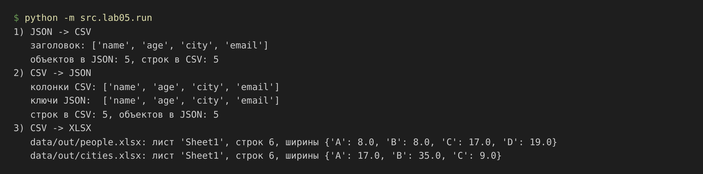
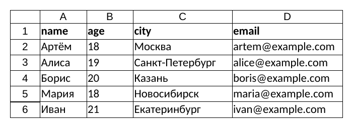
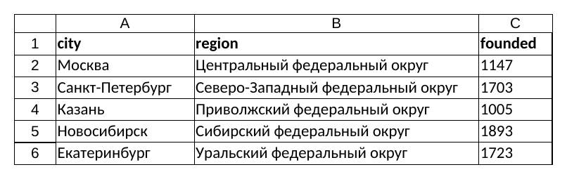
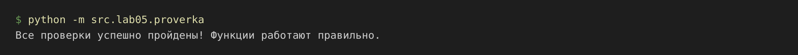
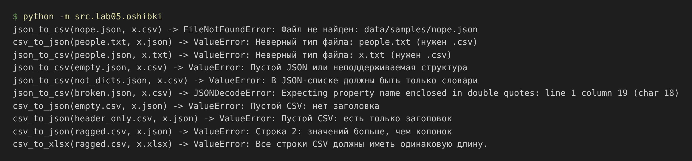

# ЛР5 — JSON и конвертации (JSON ↔ CSV, CSV → XLSX)

ЦЕЛЬ РАБОТЫ:
Разобраться с форматом JSON, сериализацией/десериализацией и табличными
конвертациями. Продолжение ЛР4: используется `ensure_parent_dir` из `src/lab04/io_txt_csv.py`.

## Установка и запуск

Нужна одна внешняя библиотека — `openpyxl` (остальное — стандартные `json`, `csv`, `pathlib`):
```
pip install -r requirements.txt
```
Все команды запускаются из корня репозитория:
```
python -m src.lab05.run        # три сценария демонстрации
python -m src.lab05.proverka   # проверки через assert
python -m src.lab05.oshibki    # примеры ошибок
```

## Структура

```
src/lib/io_helpers.py        # check_path — проверка расширения и наличия файла
src/lab05/json_csv.py        # задание A: json_to_csv, csv_to_json
src/lab05/csv_xlsx.py        # задание B: csv_to_xlsx
src/lab05/run.py             # сценарии демонстрации
src/lab05/proverka.py        # assert-проверки
src/lab05/oshibki.py         # демонстрация ошибок
data/samples/                # входные файлы: people.json, people.csv, cities.csv, students.json
data/samples/errors/         # файлы с ошибками для проверок
data/out/                    # результаты конвертаций
```

## Допущения

- **Порядок колонок в JSON → CSV** — как в первом объекте. Если в следующих объектах есть новые ключи, они добавляются в конец (пример — `students.json`).
- Отсутствующие поля заполняются пустой строкой (`restval=""`).
- Вложенные списки и словари в JSON → CSV записываются JSON-строкой: `["Python", "Git"]`.
- **CSV → JSON**: значения сохраняются строками (`"age": "18"`), в CSV нет типов.
- **CSV → XLSX**: значения тоже записываются как текст, заголовок — жирный, лист `Sheet1`.
- Ширина колонки = длина самого длинного текста + 2, но не меньше 8.
- Пустой файл, файл только с заголовком, пустой JSON `[]`, не-словари в списке, битый JSON, строки разной длины → `ValueError`.
- Нет входного файла → `FileNotFoundError`. Неверное расширение входа или выхода → `ValueError`.
- Кодировка везде строго UTF-8. В ТЗ модуль назван и `cvs_xlsx.py`, и `csv_xlsx.py` — выбрано `csv_xlsx.py`.

## Общий помощник — `src/lib/io_helpers.py`
```py
"""Общие помощники для работы с файлами (ЛР5 и дальше)."""
from pathlib import Path                    # удобная работа с путями к файлам


def check_path(path: str | Path, suffix: str, must_exist: bool) -> Path:
    """
    Проверяет путь к файлу и возвращает его как Path.
    suffix     — нужное расширение вместе с точкой, например ".json".
    must_exist — True для входного файла: он обязан существовать.
    Неверное расширение -> ValueError, нет входного файла -> FileNotFoundError.
    """
    p = Path(path)  # превращаем строку в Path, чтобы были .suffix и .is_file()

    # Сравниваем расширение в нижнем регистре: ".JSON" и ".json" — одно и то же
    if p.suffix.lower() != suffix:
        raise ValueError(f"Неверный тип файла: {p.name} (нужен {suffix})")

    # Входной файл должен лежать на диске, иначе конвертировать нечего
    if must_exist and not p.is_file():
        raise FileNotFoundError(f"Файл не найден: {p}")

    return p
```

## Задание A — модуль `src/lab05/json_csv.py`
```py
"""ЛР5, задание A: конвертация JSON <-> CSV."""
import csv                                  # стандартный модуль для работы с CSV
import json                                 # стандартный модуль для работы с JSON
from pathlib import Path                    # удобная работа с путями к файлам

from src.lib.io_helpers import check_path           # проверка расширения и наличия файла
from src.lab04.io_txt_csv import ensure_parent_dir  # создание папок из ЛР4


def json_to_csv(json_path: str | Path, csv_path: str | Path) -> None:
    """
    Преобразует JSON-файл (список словарей) в CSV.
    Колонки идут в порядке ключей первого объекта; если в следующих объектах
    есть новые ключи, они добавляются в конец. Отсутствующие поля — пустые строки.
    Кодировка UTF-8.
    """
    # Проверяем оба пути: вход должен быть .json и существовать, выход — .csv
    src = check_path(json_path, ".json", must_exist=True)
    dst = check_path(csv_path, ".csv", must_exist=False)

    # json.load читает файл и превращает JSON в объекты Python: [...] -> list, {...} -> dict
    # Если JSON битый, будет json.JSONDecodeError — это подкласс ValueError
    with src.open(encoding="utf-8") as f:
        data = json.load(f)

    # Нужен непустой список
    if type(data) != list or len(data) == 0:
        raise ValueError("Пустой JSON или неподдерживаемая структура")

    # Каждый элемент списка — одна строка таблицы, поэтому он должен быть словарём
    for item in data:
        if type(item) != dict:
            raise ValueError("В JSON-списке должны быть только словари")

    # Собираем заголовок: все ключи по порядку появления, без повторов
    fieldnames = []
    for item in data:
        for key in item:
            if key not in fieldnames:
                fieldnames.append(key)

    # Если все словари пустые ({}), колонок нет — таблицу не построить
    if len(fieldnames) == 0:
        raise ValueError("В объектах JSON нет ни одного поля")

    # Вложенные списки и словари записываем JSON-строкой, чтобы не потерять данные
    rows = []
    for item in data:
        row = {}
        for key, value in item.items():
            if type(value) in (list, dict):
                value = json.dumps(value, ensure_ascii=False)
            row[key] = value
        rows.append(row)

    # Создаём папку для файла, если её ещё нет
    ensure_parent_dir(dst)
    # newline="" — чтобы на Windows не появлялись пустые строки между записями
    with dst.open("w", newline="", encoding="utf-8") as f:
        # DictWriter пишет словари; restval="" — чем заполнить поле, которого нет в словаре
        writer = csv.DictWriter(f, fieldnames=fieldnames, restval="")
        writer.writeheader()        # первая строка — заголовок
        writer.writerows(rows)      # остальные строки — данные


def csv_to_json(csv_path: str | Path, json_path: str | Path) -> None:
    """
    Преобразует CSV в JSON (список словарей).
    Первая строка CSV — заголовок (обязателен), значения сохраняются как строки.
    Пишется через json.dump(..., ensure_ascii=False, indent=2).
    """
    # Проверяем оба пути: вход должен быть .csv и существовать, выход — .json
    src = check_path(csv_path, ".csv", must_exist=True)
    dst = check_path(json_path, ".json", must_exist=False)

    with src.open(encoding="utf-8", newline="") as f:
        # DictReader берёт первую строку как заголовок и отдаёт остальные строки словарями
        reader = csv.DictReader(f)

        # fieldnames — это заголовок; у пустого файла его нет, тогда там None
        header = reader.fieldnames
        if header is None:
            raise ValueError("Пустой CSV: нет заголовка")

        # Пустое имя колонки (например, "name,,city") — заголовок испорчен
        for name in header:
            if name.strip() == "":
                raise ValueError("В заголовке CSV есть пустое имя колонки")

        # Повторяющиеся имена: в словаре второе значение затёрло бы первое
        if len(set(header)) != len(header):
            raise ValueError("В заголовке CSV повторяются имена колонок")

        rows = []
        for row in reader:
            # Лишние значения DictReader складывает под ключ None
            if None in row:
                raise ValueError(f"Строка {reader.line_num}: значений больше, чем колонок")
            # Недостающие значения DictReader заполняет None — меняем на пустую строку
            for key in row:
                if row[key] is None:
                    row[key] = ""
            rows.append(row)

    # Заголовок есть, а данных нет — конвертировать нечего
    if len(rows) == 0:
        raise ValueError("Пустой CSV: есть только заголовок")

    ensure_parent_dir(dst)
    with dst.open("w", encoding="utf-8") as f:
        # ensure_ascii=False — русские буквы как есть, а не А...
        # indent=2 — каждый ключ с новой строки с отступом в 2 пробела
        json.dump(rows, f, ensure_ascii=False, indent=2)
```

## Задание B — модуль `src/lab05/csv_xlsx.py`
```py
"""ЛР5, задание B: конвертация CSV -> XLSX."""
import csv                                  # стандартный модуль для работы с CSV
from pathlib import Path                    # удобная работа с путями к файлам

from openpyxl import Workbook                       # Excel-книга (внешняя библиотека, см. requirements.txt)
from openpyxl.styles import Font                    # шрифт: сделаем заголовок жирным
from openpyxl.utils import get_column_letter        # номер колонки -> буква: 1 -> "A", 2 -> "B"

from src.lib.io_helpers import check_path           # проверка расширения и наличия файла
from src.lab04.io_txt_csv import ensure_parent_dir  # создание папок из ЛР4

MIN_WIDTH = 8   # минимальная ширина колонки в символах (по ТЗ)


def csv_to_xlsx(csv_path: str | Path, xlsx_path: str | Path) -> None:
    """
    Конвертирует CSV в XLSX через openpyxl.
    Первая строка CSV — заголовок (делаем жирным). Лист называется "Sheet1".
    Ширина колонки — по самому длинному тексту в ней, но не меньше 8 символов.
    """
    # Проверяем оба пути: вход должен быть .csv и существовать, выход — .xlsx
    src = check_path(csv_path, ".csv", must_exist=True)
    dst = check_path(xlsx_path, ".xlsx", must_exist=False)

    with src.open(encoding="utf-8", newline="") as f:
        # csv.reader отдаёт каждую строку списком; пустые строки ([]) пропускаем
        rows = [row for row in csv.reader(f) if row]

    # Пустой файл -> нет даже заголовка
    if len(rows) == 0:
        raise ValueError("Пустой CSV: нет заголовка")

    header = rows[0]
    # Пустое имя колонки — заголовок испорчен
    for name in header:
        if name.strip() == "":
            raise ValueError("В заголовке CSV есть пустое имя колонки")

    # Только заголовок без данных
    if len(rows) == 1:
        raise ValueError("Пустой CSV: есть только заголовок")

    # Все строки должны быть той же длины, что и заголовок, иначе таблица «поедет»
    for row in rows:
        if len(row) != len(header):
            raise ValueError("Все строки CSV должны иметь одинаковую длину.")

    wb = Workbook()             # новая книга Excel, в ней сразу есть один лист
    ws = wb.active              # берём этот активный лист
    ws.title = "Sheet1"         # имя листа по ТЗ

    # append добавляет список как новую строку листа: элементы -> ячейки A, B, C...
    for row in rows:
        ws.append(row)

    # ws[1] — первая строка листа (в Excel строки считаются с 1), делаем её жирной
    # Шрифт указываем явно: Font(bold=True) без name сбрасывает Calibri на шрифт по умолчанию
    for cell in ws[1]:
        cell.font = Font(name="Calibri", size=11, bold=True)

    # Автоширина: для каждой колонки ищем самый длинный текст
    for col in range(len(header)):
        longest = 0
        for row in rows:
            longest = max(longest, len(row[col]))
        # +2 — небольшой запас, чтобы текст не прилипал к границе; минимум 8 символов
        width = max(longest + 2, MIN_WIDTH)
        # column_dimensions["A"].width — ширина колонки A в символах
        ws.column_dimensions[get_column_letter(col + 1)].width = width

    # Создаём папку для файла и сохраняем книгу
    ensure_parent_dir(dst)
    wb.save(dst)
```

## Сценарии демонстрации — `src/lab05/run.py`
```py
"""ЛР5: запуск трёх сценариев демонстрации и проверка результатов."""
import csv
import json

from openpyxl import load_workbook          # открыть готовый XLSX и посмотреть, что внутри

from src.lab05.json_csv import json_to_csv, csv_to_json
from src.lab05.csv_xlsx import csv_to_xlsx


# Сценарий 1: JSON -> CSV, проверяем заголовок и количество строк
json_to_csv("data/samples/people.json", "data/out/people_from_json.csv")
json_to_csv("data/samples/students.json", "data/out/students_from_json.csv")

with open("data/samples/people.json", encoding="utf-8") as f:
    objects = json.load(f)                  # сколько объектов было в JSON
with open("data/out/people_from_json.csv", encoding="utf-8", newline="") as f:
    reader = csv.DictReader(f)
    csv_rows = list(reader)                 # сколько строк данных получилось в CSV
    header = reader.fieldnames

print("1) JSON -> CSV")
print("   заголовок:", header)
print(f"   объектов в JSON: {len(objects)}, строк в CSV: {len(csv_rows)}")

# Сценарий 2: CSV -> JSON, сравниваем ключи и количество объектов
csv_to_json("data/samples/people.csv", "data/out/people_from_csv.json")

with open("data/samples/people.csv", encoding="utf-8", newline="") as f:
    reader = csv.DictReader(f)
    src_rows = list(reader)
    src_header = reader.fieldnames
with open("data/out/people_from_csv.json", encoding="utf-8") as f:
    result = json.load(f)

print("2) CSV -> JSON")
print("   колонки CSV:", src_header)
print("   ключи JSON: ", list(result[0].keys()))
print(f"   строк в CSV: {len(src_rows)}, объектов в JSON: {len(result)}")

# Сценарий 3: CSV -> XLSX, проверяем имя листа и ширину колонок
csv_to_xlsx("data/samples/people.csv", "data/out/people.xlsx")
csv_to_xlsx("data/samples/cities.csv", "data/out/cities.xlsx")

print("3) CSV -> XLSX")
for path in ("data/out/people.xlsx", "data/out/cities.xlsx"):
    wb = load_workbook(path)
    ws = wb.active
    # column_dimensions[буква].width — ширина, которую поставила csv_to_xlsx
    widths = {letter: dim.width for letter, dim in ws.column_dimensions.items()}
    print(f"   {path}: лист {ws.title!r}, строк {ws.max_row}, ширины {widths}")
```
Вывод:



### 1. JSON → CSV: заголовок и количество строк
`data/samples/people.json` (5 объектов) → `data/out/people_from_json.csv`:
```
name,age,city,email
Артём,18,Москва,artem@example.com
Алиса,19,Санкт-Петербург,alice@example.com
Борис,20,Казань,boris@example.com
Мария,18,Новосибирск,maria@example.com
Иван,21,Екатеринбург,ivan@example.com
```
Объекты с разными ключами и вложенным списком (`data/samples/students.json`) → `data/out/students_from_json.csv`:
```
name,group,skills,email
Артём,БИВТ-26-6,"[""Python"", ""Git""]",
Алиса,БИВТ-26-6,,alice@example.com
Борис,БИВТ-26-5,"[""C++""]",
```

### 2. CSV → JSON: ключи и количество объектов
`data/samples/people.csv` (5 строк) → `data/out/people_from_csv.json` (5 объектов, ключи = колонки CSV):
```json
[
  {
    "name": "Артём",
    "age": "18",
    "city": "Москва",
    "email": "artem@example.com"
  },
  {
    "name": "Алиса",
    "age": "19",
    "city": "Санкт-Петербург",
    "email": "alice@example.com"
  },
  {
  ...
]
```

### 3. CSV → XLSX: лист и ширина колонок
`data/samples/people.csv` → `data/out/people.xlsx`



`data/samples/cities.csv` → `data/out/cities.xlsx`



Лист называется `Sheet1`, заголовок жирный. Короткие колонки `name` и `age` получили минимальную ширину 8, `region` — 35 (длина самого длинного региона + 2).

## Проверка через assert — `src/lab05/proverka.py`
```py
"""ЛР5: проверка функций через assert (правильная работа и все ошибки из ТЗ)."""
import csv
import json

from openpyxl import load_workbook

from src.lab05.json_csv import json_to_csv, csv_to_json
from src.lab05.csv_xlsx import csv_to_xlsx

OUT = "data/out/proverka"   # сюда пишем временные результаты проверок
ERR = "data/samples/errors" # файлы с ошибками для проверок


def raises(error_type, func, *args) -> bool:
    """Возвращает True, если func(*args) упала именно с ошибкой error_type."""
    try:
        func(*args)
    except error_type:
        return True
    return False


# ---------- JSON -> CSV ----------
json_to_csv("data/samples/people.json", f"{OUT}/people.csv")
with open(f"{OUT}/people.csv", encoding="utf-8", newline="") as f:
    reader = csv.DictReader(f)
    rows = list(reader)
assert reader.fieldnames == ["name", "age", "city", "email"], "Ошибка в json_to_csv (порядок колонок)"
assert len(rows) == 5, "Ошибка в json_to_csv (количество строк)"
assert rows[0]["name"] == "Артём" and rows[0]["age"] == "18", "Ошибка в json_to_csv (значения)"

json_to_csv("data/samples/students.json", f"{OUT}/students.csv")
with open(f"{OUT}/students.csv", encoding="utf-8", newline="") as f:
    reader = csv.DictReader(f)
    rows = list(reader)
assert reader.fieldnames == ["name", "group", "skills", "email"], "Ошибка в json_to_csv (объединение ключей)"
assert rows[0]["email"] == "", "Ошибка в json_to_csv (пустое поле вместо отсутствующего)"
assert rows[0]["skills"] == '["Python", "Git"]', "Ошибка в json_to_csv (вложенный список)"

# ---------- CSV -> JSON ----------
csv_to_json("data/samples/people.csv", f"{OUT}/people.json")
with open(f"{OUT}/people.json", encoding="utf-8") as f:
    data = json.load(f)
assert len(data) == 5, "Ошибка в csv_to_json (количество объектов)"
assert list(data[0].keys()) == ["name", "age", "city", "email"], "Ошибка в csv_to_json (ключи)"
assert data[0]["age"] == "18", "Ошибка в csv_to_json (значения должны быть строками)"

# Туда и обратно: JSON -> CSV -> JSON даёт те же записи (возраст стал строкой)
csv_to_json(f"{OUT}/people.csv", f"{OUT}/round.json")
with open("data/samples/people.json", encoding="utf-8") as f:
    original = json.load(f)
with open(f"{OUT}/round.json", encoding="utf-8") as f:
    back = json.load(f)
assert back == [{k: str(v) for k, v in item.items()} for item in original], "Ошибка в обратимом преобразовании"

# ---------- CSV -> XLSX ----------
csv_to_xlsx("data/samples/cities.csv", f"{OUT}/cities.xlsx")
ws = load_workbook(f"{OUT}/cities.xlsx").active
assert ws.title == "Sheet1", "Ошибка в csv_to_xlsx (имя листа)"
assert ws.max_row == 6, "Ошибка в csv_to_xlsx (количество строк: заголовок + 5)"
assert ws["A1"].value == "city" and ws["A1"].font.bold, "Ошибка в csv_to_xlsx (заголовок)"
assert ws.column_dimensions["C"].width == 9, "Ошибка в csv_to_xlsx (ширина: len('founded') + 2 = 9)"
assert ws.column_dimensions["A"].width >= 8, "Ошибка в csv_to_xlsx (ширина не меньше 8)"

# ---------- Ошибки ----------
# Нет файла -> FileNotFoundError
assert raises(FileNotFoundError, json_to_csv, "data/samples/nope.json", f"{OUT}/x.csv"), "Нет FileNotFoundError (json_to_csv)"
assert raises(FileNotFoundError, csv_to_json, "data/samples/nope.csv", f"{OUT}/x.json"), "Нет FileNotFoundError (csv_to_json)"
assert raises(FileNotFoundError, csv_to_xlsx, "data/samples/nope.csv", f"{OUT}/x.xlsx"), "Нет FileNotFoundError (csv_to_xlsx)"

# Неверный тип файла -> ValueError
assert raises(ValueError, csv_to_json, f"{ERR}/people.txt", f"{OUT}/x.json"), "Нет ValueError (вход .txt)"
assert raises(ValueError, json_to_csv, "data/samples/people.json", f"{OUT}/x.txt"), "Нет ValueError (выход .txt)"
assert raises(ValueError, csv_to_xlsx, "data/samples/people.csv", f"{OUT}/x.xls"), "Нет ValueError (выход .xls)"

# Пустой / неправильный JSON -> ValueError
assert raises(ValueError, json_to_csv, f"{ERR}/empty.json", f"{OUT}/x.csv"), "Нет ValueError (пустой JSON)"
assert raises(ValueError, json_to_csv, f"{ERR}/not_dicts.json", f"{OUT}/x.csv"), "Нет ValueError (не словари)"
assert raises(ValueError, json_to_csv, f"{ERR}/broken.json", f"{OUT}/x.csv"), "Нет ValueError (битый JSON)"

# Пустой / неправильный CSV -> ValueError
for func, out in ((csv_to_json, f"{OUT}/x.json"), (csv_to_xlsx, f"{OUT}/x.xlsx")):
    assert raises(ValueError, func, f"{ERR}/empty.csv", out), "Нет ValueError (пустой CSV)"
    assert raises(ValueError, func, f"{ERR}/header_only.csv", out), "Нет ValueError (только заголовок)"
    assert raises(ValueError, func, f"{ERR}/ragged.csv", out), "Нет ValueError (строка длиннее заголовка)"

print("Все проверки успешно пройдены! Функции работают правильно.")
```
Вывод:



## Ошибки — `src/lab05/oshibki.py`
```py
"""ЛР5: демонстрация ошибок — какие файлы функции не принимают и что они говорят."""
from src.lab05.json_csv import json_to_csv, csv_to_json
from src.lab05.csv_xlsx import csv_to_xlsx

ERR = "data/samples/errors"   # файлы с ошибками
OUT = "data/out/oshibki"      # сюда ничего не запишется: все вызовы падают раньше

# (функция, входной файл, выходной файл)
cases = [
    (json_to_csv, "data/samples/nope.json", f"{OUT}/x.csv"),        # файла нет
    (csv_to_json, f"{ERR}/people.txt", f"{OUT}/x.json"),            # вход не .csv
    (json_to_csv, "data/samples/people.json", f"{OUT}/x.txt"),      # выход не .csv
    (json_to_csv, f"{ERR}/empty.json", f"{OUT}/x.csv"),             # []
    (json_to_csv, f"{ERR}/not_dicts.json", f"{OUT}/x.csv"),         # в списке не только словари
    (json_to_csv, f"{ERR}/broken.json", f"{OUT}/x.csv"),            # битый JSON
    (csv_to_json, f"{ERR}/empty.csv", f"{OUT}/x.json"),             # пустой файл
    (csv_to_json, f"{ERR}/header_only.csv", f"{OUT}/x.json"),       # только заголовок
    (csv_to_json, f"{ERR}/ragged.csv", f"{OUT}/x.json"),            # лишнее значение в строке
    (csv_to_xlsx, f"{ERR}/ragged.csv", f"{OUT}/x.xlsx"),            # то же для XLSX
]

for func, src, dst in cases:
    try:
        func(src, dst)
        print(f"{func.__name__}({src}) — ошибки нет?!")
    except (FileNotFoundError, ValueError) as e:
        # type(e).__name__ — имя класса ошибки, например "ValueError"
        print(f"{func.__name__}({src.split('/')[-1]}, {dst.split('/')[-1]}) -> {type(e).__name__}: {e}")
```
Вывод:



`json.JSONDecodeError` — подкласс `ValueError`, поэтому битый JSON тоже ловится через `except ValueError`.
