# ЛР6 — CLI‑утилиты с argparse (cat/stats + конвертеры)


ЦЕЛЬ РАБОТЫ:
Научиться создавать консольные инструменты с аргументами командной строки, подкомандами и флагами. Продолжение ЛР5 (использование ранее написанных функций конвертации) и подготовка к ЛР7 (тестирование).

## Установка и запуск

Для работы конвертеров в Excel (`csv2xlsx`) требуется ранее установленная библиотека `openpyxl` из ЛР5. Остальное — стандартная библиотека Python.
Все команды запускаются из корня репозитория через флаг `-m`:
```bash
python -m src.lab06.cli_text       # утилиты для работы с текстом
python -m src.lab06.cli_convert    # конвертеры данных 
```

## Структура 

src/lab06/cli_text.py        # задание 1: cat, stats (с использованием функций ЛР3)
src/lab06/cli_convert.py     # задание 2: json2csv, csv2json, csv2xlsx (функции ЛР5)
src/lab06/__init__.py        # файл для обозначения пакета
data/samples/                # входные файлы (people.json, people.csv, text.txt и др.)
data/out/lab06/              # результаты работы конвертеров
images/lab06/                # скриншоты работы программ

## Задание 1 — Модуль src/lab06/cli_text.py

Реализует команду cat для вывода файла (с опциональной нумерацией строк) и команду stats для анализа частот слов в тексте.

```py
import argparse
from pathlib import Path
from src.lib.text_utils import normalize, tokenize, count_freq, top_n 

def main():
    parser = argparse.ArgumentParser(description="CLI-утилиты лабораторной №6 (работа с текстом)")
    subparsers = parser.add_subparsers(dest="command", title="Доступные команды")

    # подкоманда cat
    cat_parser = subparsers.add_parser("cat", help="Вывести содержимое файла")
    cat_parser.add_argument("--input", required=True, help="Путь к файлу")
    cat_parser.add_argument("-n", dest="number", action="store_true", help="Нумеровать строки")

    # подкоманда stats
    stats_parser = subparsers.add_parser("stats", help="Анализ частот слов в тексте")
    stats_parser.add_argument("--input", required=True, help="Путь к текстовому файлу")
    stats_parser.add_argument("--top", type=int, default=5, help="Количество топ-слов (по умолчанию 5)")

    args = parser.parse_args()

    if args.command is None:
        parser.error("не указана подкоманда: cat | stats")

    try:
        if args.command == "cat":
            with open(args.input, "r", encoding="utf-8") as f:
                for i, line in enumerate(f, start=1):
                    if args.number:
                        print(f"{i:4}: {line}", end="")
                    else:
                        print(line, end="")
                        
        elif args.command == "stats":
            text = Path(args.input).read_text(encoding="utf-8")
            words = tokenize(normalize(text))
            top_words = top_n(count_freq(words), args.top)
            
            print(f"Топ {args.top} слов:")
            for word, count in top_words:
                print(f"{word}: {count}")

    except FileNotFoundError:
        parser.error(f"файл не найден: {args.input}")
    except Exception as e:
        parser.error(str(e))

if __name__ == "__main__":
    main()
```

1 Вывод:
```bash
python -m src.lab06.cli_text cat --input data/samples/people.csv -n
```
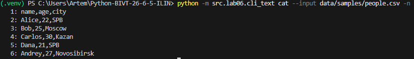

2 Вывод 
```bash
python -m src.lab06.cli_text stats --input data/samples/stats.txt --top 3
```
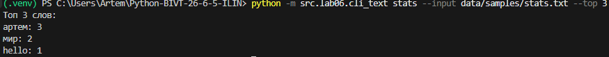

## Задание 2 — Модуль src/lab06/cli_convert.py

Обертка над функциями из ЛР5 (json_to_csv, csv_to_json, csv_to_xlsx) с использованием CLI-интерфейса.

```py
import argparse
from src.lab05.csv_xlsx import csv_to_xlsx
from src.lab05.json_csv import json_to_csv
from src.lab05.json_csv import csv_to_json

def main():
    parser = argparse.ArgumentParser(description="Конвертер данных (JSON, CSV, XLSX)")
    subparse = parser.add_subparsers(dest='command', title="Доступные команды")

    json2csv = subparse.add_parser('json2csv', help="Конвертировать JSON в CSV")
    json2csv.add_argument('--in', dest='input', required=True, help="Путь к исходному JSON файлу")
    json2csv.add_argument('--out', dest='output', required=True, help="Путь для сохранения CSV файла")

    csv2json = subparse.add_parser('csv2json', help="Конвертировать CSV в JSON")
    csv2json.add_argument('--in', dest='input', required=True, help="Путь к исходному CSV файлу")
    csv2json.add_argument('--out', dest='output', required=True, help="Путь для сохранения JSON файла")

    csv2xlsx = subparse.add_parser('csv2xlsx', help="Конвертировать CSV в XLSX (Excel)")
    csv2xlsx.add_argument('--in', dest='input', required=True, help="Путь к исходному CSV файлу")
    csv2xlsx.add_argument('--out', dest='output', required=True, help="Путь для сохранения XLSX файла")

    args = parser.parse_args()

    if args.command is None:
        parser.error("не указана подкоманда: json2csv | csv2json | csv2xlsx")

    try:
        if args.command == "json2csv":
            json_to_csv(args.input, args.output)
        elif args.command == "csv2json":
            csv_to_json(args.input, args.output)
        elif args.command == "csv2xlsx":
            csv_to_xlsx(args.input, args.output)
    except FileNotFoundError as e:
        parser.error(f"файл не найден: {e}")
    except (OSError, ValueError) as e:
        parser.error(str(e))
    else:
        print(f"OK: {args.command}: {args.input} -> {args.output}")

if __name__=='__main__':
    main()
```

1. JSON → CSV
```bash
python -m src.lab06.cli_convert json2csv --in data/samples/people.json --out data/out/lab06/people.csv
```
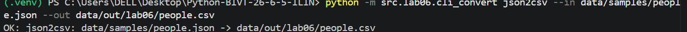

2. CSV → JSON
```bash
python -m src.lab06.cli_convert csv2json --in data/samples/people.csv --out data/out/lab06/people.json
```
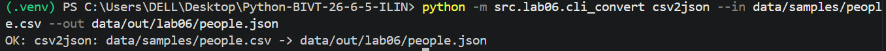

3. CSV → XLSX
```bash
python -m src.lab06.cli_convert csv2xlsx --in data/samples/people.csv --out data/out/lab06/people.xlsx
```
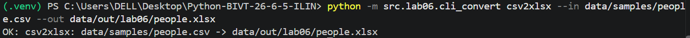

## help

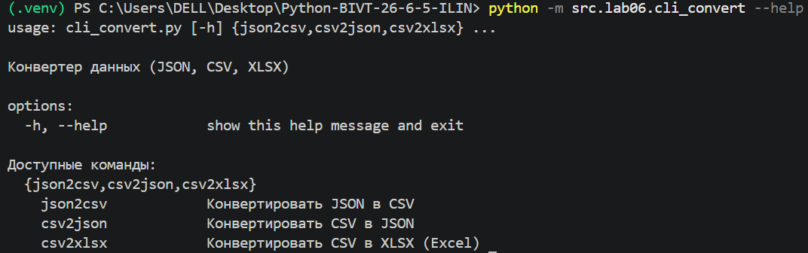
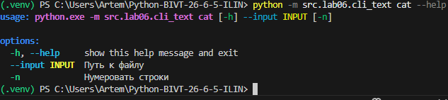
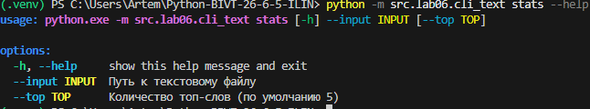
## Ошибки:

### Invalid argument
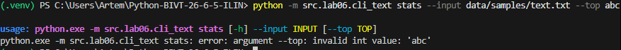
### Not command
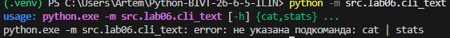
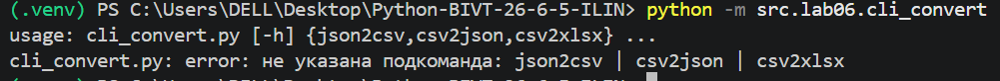
### Not found 
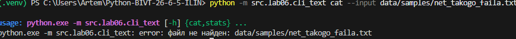