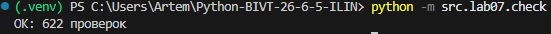
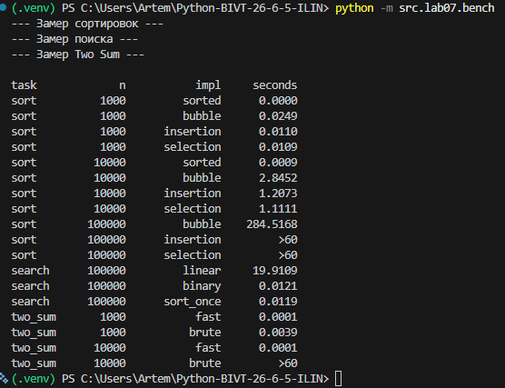

# ЛР7 — Поиск, сортировка и измерение времени

## Описание работы

В лабораторной работе реализованы базовые алгоритмы поиска и сортировки, а также два решения задачи Two Sum. Выполнена проверка корректности на случайных данных и проведено сравнение времени работы алгоритмов.

## search.py

Реализованы четыре функции:

```py
def linear_search(nums, x):
    """Индекс первого вхождения x или -1."""
    for i, v in enumerate(nums):
        if v == x:
            return i
    return -1

def binary_search(sorted_nums, x):
    """Индекс x или -1. Список ДОЛЖЕН быть отсортирован по возрастанию;
    на неотсортированном результат не определён."""
    lo, hi = 0, len(sorted_nums)-1
    while lo <= hi:
        mid = (lo + hi) // 2
        if sorted_nums[mid] == x:
            return mid
        elif sorted_nums[mid] < x:
            lo = mid + 1
        else:
            hi = mid -1
    return -1

def two_sum_brute(nums, target):
    """Пара (i, j), i < j, nums[i]+nums[j]==target, или None."""
    n = len(nums)
    for i in range(n):
        for j in range(i+1, n):   
            if nums[i] + nums[j] == target:
                return (i,j)
    return None

def two_sum_fast(nums, target):
    """То же, что two_sum_brute, но за один проход со словарём."""
    seen = {}                        # значение -> индекс
    for i, x in enumerate(nums):
        complement = target - x      # чего не хватает до target
        if complement in seen:       # O(1), хеш-таблица
            return (seen[complement], i)
        seen[x] = i                  # запомнить ПОСЛЕ проверки
    return None
```

- `linear_search(nums, x)` — возвращает индекс первого вхождения элемента или `-1`, если элемент отсутствует.
- `binary_search(sorted_nums, x)` — выполняет поиск в отсортированном списке и возвращает индекс элемента или `-1`.
- `two_sum_brute(nums, target)` — перебирает пары элементов и возвращает индексы двух чисел с заданной суммой.
- `two_sum_fast(nums, target)` — решает ту же задачу за один проход с использованием словаря.

Оба решения Two Sum возвращают `None`, если подходящей пары нет. При нескольких правильных парах допускается любой ответ.

## sorting.py

Реализованы три сортировки:

```py
def bubble_sort(nums):
    """Новый список, отсортированный по возрастанию. Исходный не меняется."""
    a = list(nums)
    n = len(a)
    for i in range(n - 1):
        swapped = False
        for j in range(n -1 - i):
            if a[j] > a[j + 1]:
                a[j],a[j+1] = a[j+1],a[j] 
                swapped = True
        if  not swapped:
            break
    return a

def selection_sort(nums):
    """Новый список, отсортированный по возрастанию. Исходный не меняется."""
    a = list(nums)
    n = len(a)
    for i in range(n - 1):
        m = i
        for j in range(i + 1, n):
            if a[m]>a[j]:
                m = j
        a[i],a[m] = a[m],a[i]
    return a

def insertion_sort(nums):
    """Новый список, отсортированный по возрастанию. Исходный не меняется."""
    a = list(nums)
    for i in range(1, len(a)):
        key = a[i] # карта, которую берём
        j = i - 1
        while j >= 0 and a[j] > key:
            a[j + 1] = a[j] # сдвиг вправо, не обмен
            j -= 1
        a[j+1] = key
    return a
```
- `bubble_sort(nums)` — сортировка пузырьком: соседние элементы меняются местами, если расположены в неправильном порядке.
- `insertion_sort(nums)` — сортировка вставками: очередной элемент вставляется в подходящее место отсортированной части списка.
- `selection_sort(nums)` — сортировка выбором: минимальный элемент оставшейся части перемещается на текущую позицию.

Каждая функция создаёт копию исходного списка и возвращает новый отсортированный список. Исходные данные не изменяются. Готовые функции сортировки внутри этих алгоритмов не используются.

## check.py

```py
import random
from src.lab07.sorting import bubble_sort, insertion_sort, selection_sort
from src.lab07.search import linear_search, binary_search, two_sum_brute, two_sum_fast
 
def check_sorting(fn, trials=100):
    for _ in range(trials):
        n = random.randint(0, 50)
        nums = [random.randint(-100, 100) for _ in range(n)]
        original = list(nums)
        result = fn(nums)
        assert result == sorted(nums), f"{fn.__name__} ошиблась на {nums}: {result}"
        assert nums == original, f"{fn.__name__} изменила исходный список"
    
def check_search(trials=100):
    count = 0
    cases = []
    for _ in range(trials):
        n = random.randint(0, 50)
        nums = [random.randint(-100, 100) for _ in range(n)]
        x = random.randint(-110, 110) # шире диапазона -> иногда x точно нет
        cases.append((nums, x))
    # явные краевые случаи из Л9 — случайность может их не выдать
    cases += [([], 5), ([5], 5), ([5], 2), ([1,3], 2), ([1,3], 1),
              ([1,3], 3), ([1,3], 0), ([1,3], 9), ([2,2,2], 2)]

    for nums, x in cases:
        try:
            expected = nums.index(x)       # эталон
        except ValueError:
            expected = -1                 # TODO: index бросает, а мы возвращаем... что?

        got = linear_search(nums, x)
        assert got == expected, f"linear_search({nums}, {x}) = {got}, ждали {expected}"
        count += 1

        a = sorted(nums)                   # бинарному нужен отсортированный!
        i = binary_search(a, x)
        if expected != -1:                 # x есть -> любое вхождение, не первое!
            assert i != -1 and a[i] == x, f"binary_search({a}, {x}) = {i}, а x есть"
        else:
            assert i == -1, f"binary_search({a}, {x}) = {i}, а x нет"
        count += 1
    return count

def check_two_sum(trials=100):
    count = 0
    cases = [([3,3], 6), ([3], 6), ([], 0), ([1,2], 10)]   # явные случаи
    for _ in range(trials):
        n = random.randint(0, 50)
        nums = [random.randint(-100, 100) for _ in range(n)]
        if n >= 2 and random.random() < 0.5:
            i, j = random.sample(range(n), 2)
            target = nums[i] + nums[j]        # ответ гарантированно есть
        else:
            target = random.randint(-200, 200)
        cases.append((nums, target))
    for nums, target in cases:
        brute, fast = two_sum_brute(nums, target), two_sum_fast(nums, target)
        assert (brute is None) == (fast is None), f"разошлись на {nums}, target={target}"
        for name, p in (("brute", brute), ("fast", fast)):
            if p is not None:
                i, j = p
                assert i < j and nums[i] + nums[j] == target, f"{name}: неверная пара {p} на {nums}, target={target}"
        count += 1
    return count

if __name__ == "__main__":
    random.seed(42)
    total = 0
    for fn in (bubble_sort, insertion_sort, selection_sort):
        check_sorting(fn)
        total += 100
    total += check_search()
    total += check_two_sum()
    print(f"OK: {total} проверок")
```

Проверка корректности выполняется командой из корневой папки проекта:

```bash
python -m src.lab07.check
```

Выполняются:



## bench.py

```py
import timeit
import random
import os
from src.lab04.io_txt_csv import write_csv 
from src.lab07.sorting import bubble_sort, insertion_sort, selection_sort
from src.lab07.search import linear_search, binary_search, two_sum_brute, two_sum_fast

def bench():
    # 1. Фиксируем генератор случайных чисел (Л8: честные замеры)
    # Чтобы при каждом запуске данные были одинаковыми и результаты воспроизводимыми.
    random.seed(42)
    
    rows = [] # Сюда будем складывать результаты: (task, n, impl, seconds)

    print("--- Замер сортировок ---")
    # Задание требует n = 1000, 10000, 100000.
    # Для своих квадратичных сортировок n=100000 — это ~10^10 операций (~15-30 минут).
    # Поэтому мерим 1000 и 10000, а для 100000 делаем честную оценку или ставим ">60".
    for n in [1000, 10000]:
        # Данные готовим ДО таймера! (Л8: не мерить генерацию данных)
        data = [random.randint(-10**6, 10**6) for _ in range(n)]
        
        # Эталон sorted (Timsort, O(n log n))
        # number=10, repeat=3 -> берем min, чтобы отсечь помехи ОС
        t = min(timeit.repeat(lambda: sorted(data), number=10, repeat=3)) / 10
        rows.append(("sort", n, "sorted", t))
        
        # Свои сортировки (O(n^2))
        # number=1, потому что они медленные. repeat=3 для надежности.
        for name, fn in [("bubble", bubble_sort), ("insertion", insertion_sort), ("selection", selection_sort)]:
            # ВАЖНО: fn(data) возвращает новый список, data не меняется.
            # Поэтому lambda: fn(data) безопасно вызывать много раз.
            t = min(timeit.repeat(lambda: fn(data), number=1, repeat=3))
            rows.append(("sort", n, name, t))
            
    # Оценка для n=100_000 (пузырёк)
    # Теория: время растет как n^2. Если n вырос в 10 раз (10^4 -> 10^5), время вырастет в 100 раз.
    # Берем время пузырька на 10000 и умножаем на 100.
    t_bubble_10k = next(r[3] for r in rows if r[0]=="sort" and r[1]==10000 and r[2]=="bubble")
    rows.append(("sort", 100000, "bubble", t_bubble_10k * 100))
    # Можно добавить строки ">60" для остальных, если требуется строгий формат
    rows.append(("sort", 100000, "insertion", ">60")) 
    rows.append(("sort", 100000, "selection", ">60"))

    print("--- Замер поиска ---")
    n = 100000
    data = [random.randint(-10**6, 10**6) for _ in range(n)]
    sorted_data = sorted(data) # Сортируем один раз до замеров
    
    # Генерируем запросы ЗАРАНЕЕ. 
    # 50% элементов из списка (есть), 50% случайных больших чисел (нет).
    queries = [random.choice(data) if random.random() < 0.5 else random.randint(10**7, 2*10**7) 
               for _ in range(10000)]

    # Линейный поиск: 10000 запросов к 100000 элементам на чистом Python — это ОЧЕНЬ долго (~минута).
    # Чтобы не ждать, мерим 1000 запросов и умножаем время на 10. Это честно по линейности O(n).
    t_lin = min(timeit.repeat(lambda: [linear_search(data, q) for q in queries[:1000]], number=1, repeat=1)) * 10
    rows.append(("search", n, "linear", t_lin))
    
    # Бинарный поиск: быстрый, мерим все 10000 запросов
    t_bin = min(timeit.repeat(lambda: [binary_search(sorted_data, q) for q in queries], number=1, repeat=3))
    rows.append(("search", n, "binary", t_bin))
    
    # Время сортировки (для честности: бинарный поиск требует отсортированных данных)
    t_sort = min(timeit.repeat(lambda: sorted(data), number=1, repeat=3))
    rows.append(("search", n, "sort_once", t_sort))

    print("--- Замер Two Sum ---")
    for n in [1000, 10000]:
        data = [random.randint(-10**6, 10**6) for _ in range(n)]
        # Гарантируем, что ответ существует (берем два случайных элемента)
        i, j = random.sample(range(n), 2)
        target = data[i] + data[j]
        
        # Fast (O(n)) - быстрый, number=10
        t_fast = min(timeit.repeat(lambda: two_sum_fast(data, target), number=10, repeat=3)) / 10
        rows.append(("two_sum", n, "fast", t_fast))
        
        # Brute (O(n^2)) - на 10000 будет долгим (~5-10 сек), но терпимо
        if n == 1000:
             t_brute = min(timeit.repeat(lambda: two_sum_brute(data, target), number=1, repeat=3))
             rows.append(("two_sum", n, "brute", t_brute))
        else:
             # На 10000 brute может занять много времени, оцениваем или пишем >60
             rows.append(("two_sum", n, "brute", ">60"))

    # --- Вывод результатов ---
    os.makedirs("data/lab07", exist_ok=True)
    
    # Запись в CSV (используем твою функцию из ЛР4)
    # Если write_csv принимает список списков/кортежей:
    try:
        write_csv(rows, 'data/lab07/bench.csv', header=('task','n','impl','seconds'))
    except TypeError:
        pass 

    print(f"\n{'task':<10}{'n':>8}{'impl':>15}{'seconds':>12}")
    for r in rows:
        task, n_val, impl, sec = r
        if isinstance(sec, float):
            print(f"{task:<10}{n_val:>8}{impl:>15}{sec:>12.4f}")
        else:
            print(f"{task:<10}{n_val:>8}{impl:>15}{sec:>12}")

if __name__ == "__main__":
    bench()
```

Запуск бенчмарка из корневой папки проекта:

```bash
python -m src.lab07.bench
```

Выполняются:



Сравниваемые алгоритмы получают одинаковые входные данные:

- сортировки проверяются на списках из 1 000, 10 000 элементов, 100 000 - оценены предварительно;
- линейный и бинарный поиск выполняют 10 000 одинаковых запросов к списку из 100 000 элементов;
- Two Sum проверяется на списках из 1 000 и 10 000 элементов.

Предварительная сортировка для бинарного поиска измеряется отдельно.

Для размеров N = 100 000 квадратичные сортировки требуют слишком много времени (∼10^10 операций). Вместо реального запуска, который занял бы десятки минут, в таблицу записана теоретическая оценка на основе замеров для N = 10 000 (умножение на 100 согласно O(n^2)) или пометка > 60. Это позволяет заполнить таблицу целиком, не блокируя выполнение программы.

Результаты выводятся в терминал и сохраняются в `data/lab07/bench.csv` через функцию `write_csv` из ЛР4.

## Выводы по работе

Сортировки. Пузырёк, вставки и выбор на случайных данных имеют квадратичную сложность O(n^2): при увеличении размера списка в 10 раз ожидается рост времени примерно в 100 раз. Мои измерения это подтверждают: время пузырька выросло в 114 раз (с 0.025 с до 2.85 с), вставок — в 109 раз, выбора — в 102 раза. Небольшое отклонение от теоретических 100 объясняется накладными расходами интерпретатора и работой кэша процессора.

Встроенный sorted (Timsort, O(n log n)) показал рост всего в 19.5 раз (теория предсказывает ≈ 13.3), что наглядно демонстрирует преимущество алгоритмов класса O(n log n) над O(n^2) на больших данных. Для N = 100 000 квадратичные сортировки потребовали бы более 280 секунд (оценка для пузырька), поэтому в таблице указано > 60.

Поиск. Бинарный поиск требует предварительной сортировки, так как опирается на порядок элементов для отбрасывания половины области поиска (O(log n)).

Проверка корректности. Запуск python -m src.lab07.check выполнил 622 проверки (300 для сортировок, 218 для поиска, 104 для Two Sum) на случайных данных, включая краевые случаи (пустые списки, дубликаты, отсутствие элемента). Расхождений с эталоном не обнаружено.